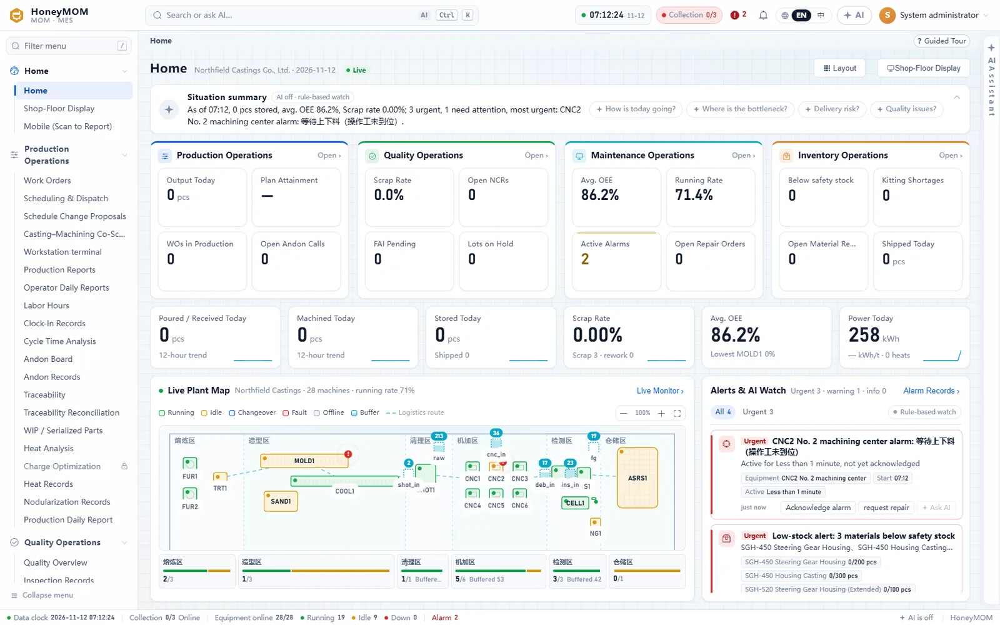
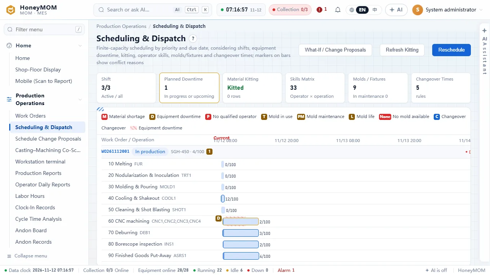
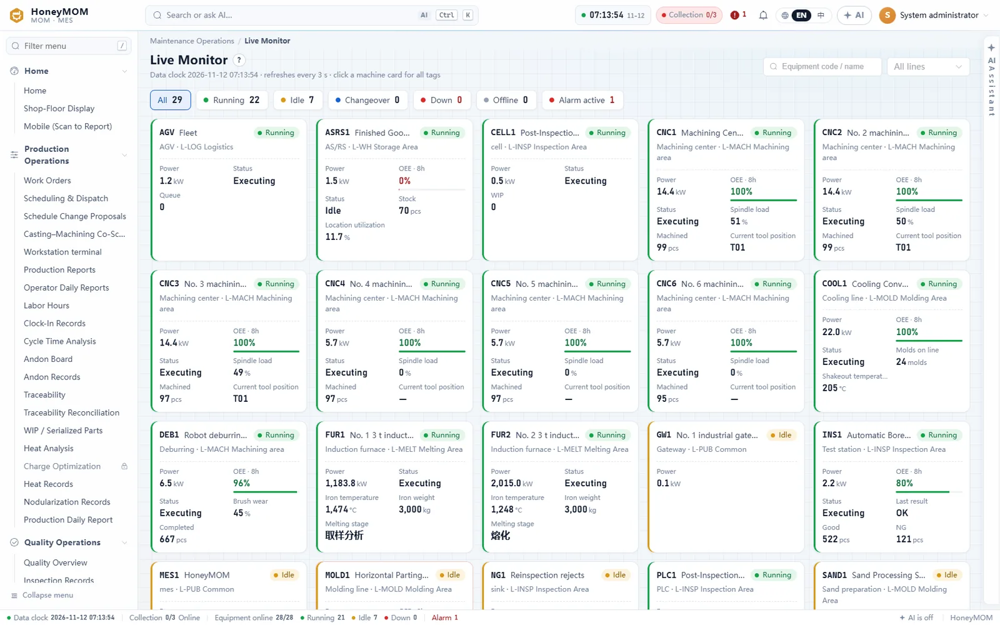
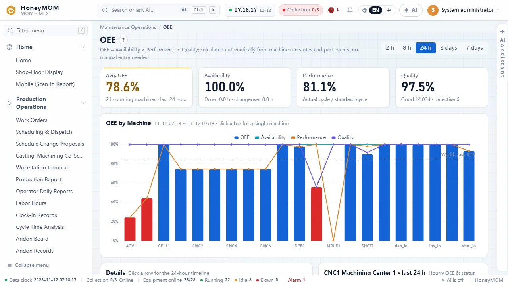
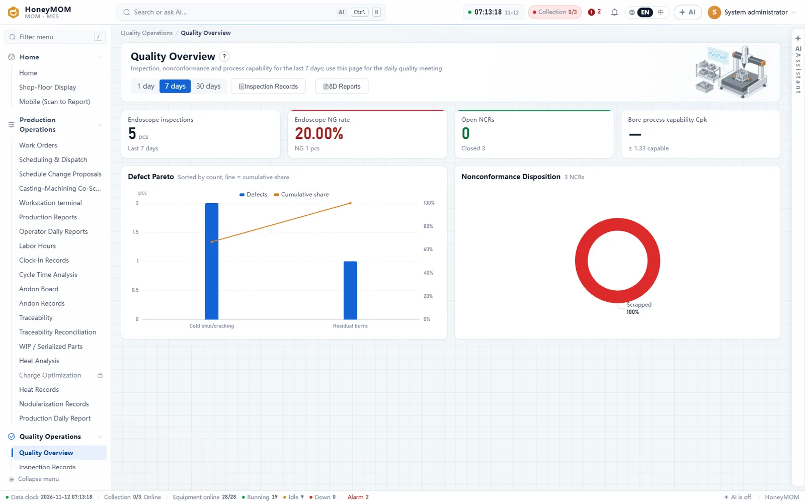
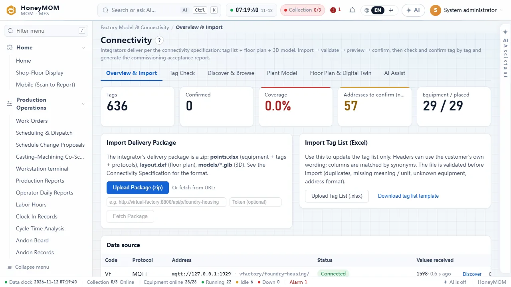

# HoneyMOM（蜂元智能 MOM）

[English](README.md) | **简体中文**

[](https://github.com/HoneyMeta/HoneyMOM/actions/workflows/ci.yml)
[](LICENSE)

HoneyMOM 是开源的制造运营管理（MOM/MES）系统，面向离散制造工厂，最先为铸造厂、机加工厂和铸造 + 机加一体化工厂设计。
它覆盖 ISA-95 第 3 层的四个领域（生产、质量、维护、库存运营），内置 ERP（销售、采购、MRP、成本），
自己通过 MQTT、Sparkplug B、OPC UA、Modbus TCP、HTTP 推送和中间库采集设备数据。AI 功能（按权限查数据的助手、日报、
异常值守、带人工审批的智能体、供外部 AI 工具使用的 MCP 接口）可接任何 OpenAI 兼容的大模型，管理员开启之前全部关闭。
后端是 Python（FastAPI、SQLAlchemy），数据库用 SQLite 或 PostgreSQL，前端是 Vue 3。
仓库里带一个数据回放器，通过 MQTT、OPC UA、Modbus 回放一座示范铸造厂录制好的 24 小时数据，没有真实工厂也能把所有功能跑起来。

- [功能](#功能)
- [截图](#截图)
- [快速开始](#快速开始)
- [配置](#配置)
- [AI 配置](#ai-配置)
- [架构](#架构)
- [路线图](#路线图)
- [许可证](#许可证)
- [参与贡献](#参与贡献)

## 功能

按 ISA-95（IEC 62264）的活动领域分组，网页左侧菜单也是这样分的。

### 生产运营

- 主数据：工厂、车间、产线、工位，物料、BOM、工艺路线，班次班组。
- 生产工单；按优先级和交期做有限产能排产，标出约束冲突（缺料、设备停机、操作工技能、模具夹具、换型时间）；
  排程调整的假设分析；派工。
- 报工：电脑、工位终端（`/station`）、手机 PWA（`/m`，扫码）。报工闸门拦下重复报工、超报、跳序，要求首检放行，冻结批次不能报工。
- 一件一码和批次，从零件追到过程数据、再反查回来，追溯对账。
- 安灯、上下工、工时、工人日报（班组长审核）、生产日报。
- 节拍分析细到设备动作（夹紧、主轴、开关门等），有基线和漂移。
- 铸造：炉次记录（成分、温度、电耗）、球化记录、最低成本配料（线性规划）。
- 机加：NC 程序审批下发、刀具台账和寿命、根据主轴负载估计刀具磨损。
- 铸造—机加：机加后暴露的缺陷回溯到炉次、浇包、浇注温度、残镁、型砂参数（卡方检验），两段协同排产。
- 标签（ZPL、TSPL、SVG、PDF）和激光打码，装箱、组托、发运通知（JSON、Excel、平面文件、EDIFACT），委外加工。

### 质量运营

- 检验模板；来料、过程、首件、出货检验。
- 不合格品处置、返修和复检，8D 报告，SPC 和过程能力。
- PFMEA（AIAG-VDA 2019 的 AP 措施优先级）→ 控制计划 → 检验模板。
- 量检具和校准（电子签名放行）；MSA（均值极差法和方差分析的 GR&R、偏倚、线性）。
- 受控文件和工程变更（ECN），带影响分析和电子签名。
- 客诉、在库影响品冻结、召回模拟。

### 维护运营

- 设备台账和实时监控、报警，OEE 由设备状态和零件事件自动算出，不用人工填。
- 点检保养计划、维修工单、备件（领用到维修单）、小时能耗。

### 库存运营

- 库存、出入库、盘点、批次冻结与解冻、物料申请和齐套、AGV 搬运任务。

### 计划与经营（内置 ERP）

- 销售：价格表、订单和交货计划、信用检查、报价、发货、退货、对账单。
- 采购：合格供方、请购、采购订单、收货转来料检验、供应商绩效。
- MRP：多层 BOM 展开，按库存、在途订单和在制工单净算，按提前期倒排，追溯到需求来源，粗能力；建议可直接下达成工单或采购订单。
- 成本（移动平均、工单实际成本、标准成本卷积、差异、月末结账），应收应付，记账凭证（导出格式可配置）。
- 外部 ERP 模式：另有 ERP 做主系统时，通过 REST 接口、带签名和重试的 Webhook、中间库交换数据。

### 设备接入

- 数据源：MQTT（统一命名空间主题）、Sparkplug B、OPC UA（订阅或轮询，浏览地址空间）、Modbus TCP、HTTP 推送、中间库表。
- 按交付包接入（点表 `points.xlsx`、平面图 `layout.dxf`、三维模型 `*.glb`）：校验、预览、确认导入，再逐点核对确认，生成联调验收报告。
- 每个点位都有时序（原始值、1 分钟和 1 小时汇总、保留策略；装了 TimescaleDB 就用它），数据库暂时不可用时断网续传，
  2D/3D 工厂地图显示实时状态。

### AI（默认关闭）

- 每个页面右侧的 AI 助手：按用户的权限和数据范围执行只读 SQL 和业务查询来回答；写操作（维修单、不合格品、安灯、物料申请、排程建议）
  先给草稿，用户确认后才执行。
- 带 AI 分析的生产日报、AI 值守（质量、设备、排程、物料）、一句话自动化、知识库问答、接入辅助（对列、补全点位含义、读 PLC 程序）。
- 智能体：可视化编排，聊天 / 定时 / 事件 / Webhook 触发，人工审批节点，逐节点调试，版本发布，允许动作白名单。
- MCP 接口（`/mcp`）：外部 AI 工具用 API 密钥查询工厂数据。
- 演示模式回放录制好的回答，不调用大模型。

### 平台

- 角色：页面 / 按钮 / 接口权限点和数据范围（工厂、车间、产线）；审计日志带哈希链；API 密钥可设到期和 IP 白名单。
- 版本化数据库迁移；每日定时和手动备份，带恢复演练。
- 不写代码的配置：自定义字段、表单布局、审批流程、报表设计器、行业模板、Excel 导入框架、开局向导。
- 行业模板：铸造、机加、注塑、装配。
- 界面和演示数据有英文和简体中文。

## 截图

示范工厂 "Northfield Castings"，数据来自回放器。

| | |
|---|---|
|  |  |
| 工作台：各运营领域指标、实时工厂地图、提醒 | 有限产能排产，标出约束冲突 |
|  |  |
| 全部设备实时监控 | 各设备 OEE，由设备状态和零件事件算出 |
|  |  |
| 质量总览：缺陷帕累托、不合格品处置 | 接入中心：导入交付包、核对点位 |

## 快速开始

### Docker（演示）

需要 Docker 和 Compose v2。

```bash
git clone https://github.com/HoneyMeta/HoneyMOM.git
cd HoneyMOM
docker compose up
```

第一次运行要构建镜像（几分钟）。然后打开 http://localhost:8900，用 `admin` / `honey123` 登录。其他演示账号：
`manager`、`planner`、`leader`、`operator`、`qc`、`maint`、`wh`、`engineer`（密码相同）。回放器开始发数据后，
驾驶舱、工厂地图和 OEE 大约一分钟内就有数。

`docker compose up` 会启动三个容器：`mom`（HoneyMOM 和网页）、`db`（PostgreSQL 17）、`replayer`（回放器）。

演示数据默认是英文；要中文演示数据，在 `.env` 里写 `MOM_DEMO_LANG=zh`（只在第一次建库时生效）。

正式部署（没有演示数据，第一次启动时创建管理员）：

```bash
cp docker/env.example .env        # 填 POSTGRES_PASSWORD、TZ 等
docker compose -f docker-compose.yml -f docker/compose.production.yml up -d
```

正式部署、备份和升级见 [docs/deployment.md](docs/deployment.md)（英文）。

### 手动安装（开发）

需要 Python 3.12 和 Node.js 20 以上。

```bash
python -m venv .venv
source .venv/bin/activate            # Windows：.venv\Scripts\activate
pip install -r requirements.txt -r replayer/requirements.txt
cd web && npm ci && npm run build && cd ..

# 终端 1：工厂数据
python -m replayer

# 终端 2：演示模式启动 HoneyMOM，SQLite 数据库在 data/mes.db
MOM_DEMO=1 python -m honeymom serve  # Windows：set MOM_DEMO=1 后再运行 python -m honeymom serve
```

打开 http://localhost:8900。不设 `MOM_DEMO=1` 就是正式安装：没有账号、没有演示数据；在浏览器里创建管理员，
或者运行 `python -m honeymom create-admin --username admin`。

改前端时在 `web/` 里运行 `npm run dev`（Vite，端口 5190，`/api` 转发到 8900）。

更多见 [docs/getting-started.md](docs/getting-started.md)。

## 配置

启动时读环境变量，常用的：

| 变量 | 默认 | 含义 |
|---|---|---|
| `MOM_DEMO` | 关 | `1`：演示账号（密码 `honey123`）和示范工厂数据。不设：正式安装。 |
| `MOM_DEMO_LANG` | `en` | 演示数据语言，`en` 或 `zh`，第一次建库时生效。 |
| `MOM_LANG` | 演示语言，否则 `en` | 请求没带语言时和后台生成的文字用的默认语言。 |
| `MOM_DB` | `sqlite:///<数据目录>/mes.db` | 数据库地址，如 `postgresql+psycopg://用户:密码@主机:5432/honeymom`。 |
| `MOM_DATA` | `./data` | 数据目录：SQLite 库、上传的文件、备份。 |
| `MOM_BACKUP_DIR` | `<数据目录>/backups` | 备份存放位置。 |
| `MOM_LLM_BASE_URL`、`MOM_LLM_API_KEY`、`MOM_LLM_MODEL` | – | AI 功能用的 OpenAI 兼容接口。 |
| `MOM_ADMIN_PASSWORD` | – | `python -m honeymom create-admin` 不提示输入时用的密码。 |

旧版本的变量名（`MES_DB`、`HM_DATA`、`MES_LLM_*` 和其他 `MES_*` / `HM_*`）仍然有效；新旧都设置时以 `MOM_*` 为准。

`python -m honeymom serve` 另有 `--http <端口>`（默认 8900）、`--host`（默认 `0.0.0.0`）、`--db <地址>`。
完整列表见 [docs/configuration.md](docs/configuration.md)。公司信息、班次、备份时间、AI 开关、MCP 限流等在网页的
**系统**菜单里改。

## AI 配置

AI 功能用 OpenAI 的 chat completions 接口格式（`POST <base_url>/chat/completions`，带工具调用），
所以云端服务和自建的 vLLM、Ollama、LM Studio 等提供 OpenAI 兼容接口的服务都能用。

1. 配置接口，用环境变量

   ```bash
   MOM_LLM_BASE_URL=https://api.example.com/v1
   MOM_LLM_API_KEY=...
   MOM_LLM_MODEL=模型名
   ```

   或者把 `config/llm.example.json` 复制成 `config/llm.local.json`（不进仓库）再填写。环境变量优先于文件；旧变量名 `MES_LLM_*` 仍然有效。
2. 用管理员登录，打开 **系统 → AI 功能**，打开总开关和需要的功能。

代码里不带任何大模型地址、模型名和密钥，仓库里也不存密钥。三项都配置好之前 AI 不会调用大模型：AI 功能用规则版，
演示模式回放录制好的回答。
配置了大模型后，带工厂数据的提示词（查询结果、页面上下文）会发到这个接口。详见 [docs/ai.md](docs/ai.md)。

## 架构

```
浏览器（电脑端、工位终端、手机 PWA、车间大屏，Vue 3）   ──HTTP /api──┐
外部 AI 工具                                            ──MCP /mcp───┤
外部 ERP                                                ──REST / Webhook / 中间库──┤
                                                                     ▼
HoneyMOM：一个 Python 进程（FastAPI）
  · 生产、质量、维护、库存、内置 ERP、排产
  · AI 助手、智能体、值守；权限、审计、备份、迁移
  · 采集：MQTT、Sparkplug B、OPC UA、Modbus TCP、HTTP 推送、中间库
      → 采集工作线程 → 业务记录 + 时序
        │                                   ▲
        │ SQLAlchemy                        │ MQTT / OPC UA / Modbus TCP
        ▼                                   │
SQLite 或 PostgreSQL（+ TimescaleDB）     PLC、网关、MQTT 服务器，或回放器
```

- `honeymom/schema*.py`：实体定义。一份定义同时生成数据库表、通用接口（`/api/e/<实体>`）和前端的列表、表单页面。
- `honeymom/services/`、`honeymom/erp/`、`honeymom/factory/`、`honeymom/impl/`、`honeymom/agent/`：业务服务、内置 ERP、
  工厂模型与接入、实施配置工具、智能体引擎。
- `honeymom/collector.py`、`honeymom/ingest.py`、`honeymom/ts.py`：协议连接器，点位值到业务记录的映射（设备状态、报警、电能、
  计数、刀具寿命、零件事件），时序。
- `honeymom/migrations/`：版本化迁移，启动时自动执行。
- `web/`：Vue 3 单页应用，构建到 `web/dist`，由后端直接提供。
- `replayer/`：按工厂提供的同样接口回放录制数据，见 [replayer/README.md](replayer/README.md)。
- `tests/`：接口和进程内检查（`*_check.py`）、浏览器走查（`*_ui.js`）。

业务时间以"数据时钟"（采集到的数据的时间）为准，所以数据源比真实时间跑得快时，报表依然正确。

## 路线图

下面是可能的方向，不是承诺；欢迎在 issue 里讨论和贡献：

- 更多的行业模板和设备模板；
- 更多界面和演示数据语言；
- Kubernetes 的 Helm chart，带 TimescaleDB 的官方镜像；
- 回放器回放 OPC UA 历史和报警事件；
- 在 CI 里跑浏览器走查（Playwright）。

## 许可证

Copyright (C) 2026 蜂元科技（郑州）有限责任公司（HoneyMeta Technology (Zhengzhou) Co., Ltd.）

HoneyMOM 采用 **GNU Affero 通用公共许可证 v3.0 或更高版本**（[LICENSE](LICENSE)）。如果你修改后通过网络给用户使用，
AGPL 要求你向这些用户提供修改后的源代码。

需要不承担 AGPL 义务的使用方式（比如放进闭源产品、做成托管服务），可以购买**商业许可证**，也可以包含带 SLA 的技术支持。
见 [COMMERCIAL-LICENSE.md](COMMERCIAL-LICENSE.md)，或联系 dev@honeymeta.com、https://www.honeymeta.com 。

第三方组件和致谢见 [THIRD-PARTY-NOTICES.md](THIRD-PARTY-NOTICES.md)。

## 参与贡献

欢迎提交问题报告、修复、翻译、设备模板和行业模板。请先读 [CONTRIBUTING.md](CONTRIBUTING.md)。
贡献者需要签一次 [CLA](CLA.md)，第一次提交 pull request 时 CLA 机器人会提示。请遵守[行为准则](CODE_OF_CONDUCT.md)，
安全问题请按 [SECURITY.md](SECURITY.md) 私下报告。

主仓库：https://github.com/HoneyMeta/HoneyMOM 。Gitee 和 GitCode 上有只读镜像。
